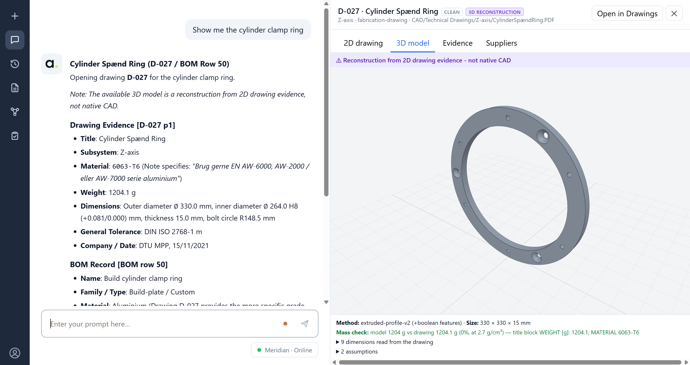
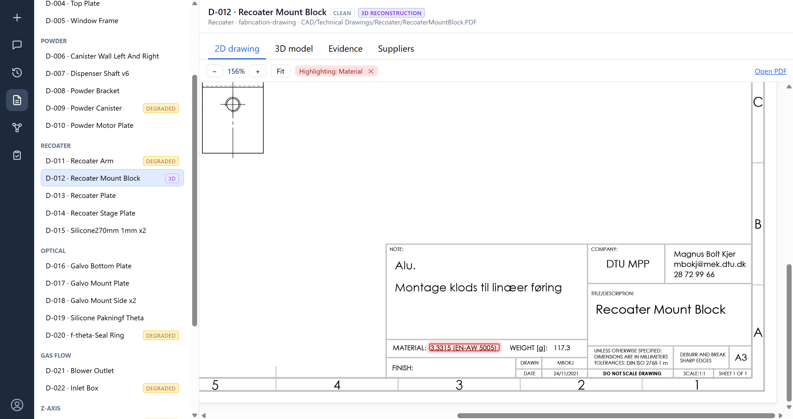
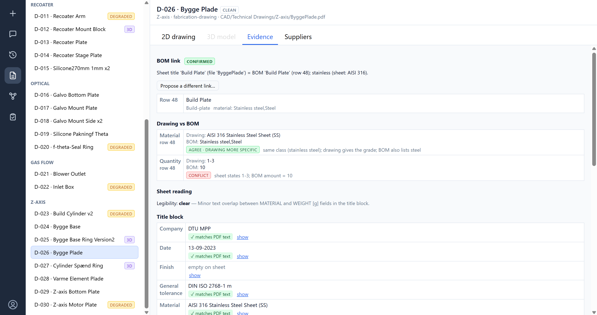
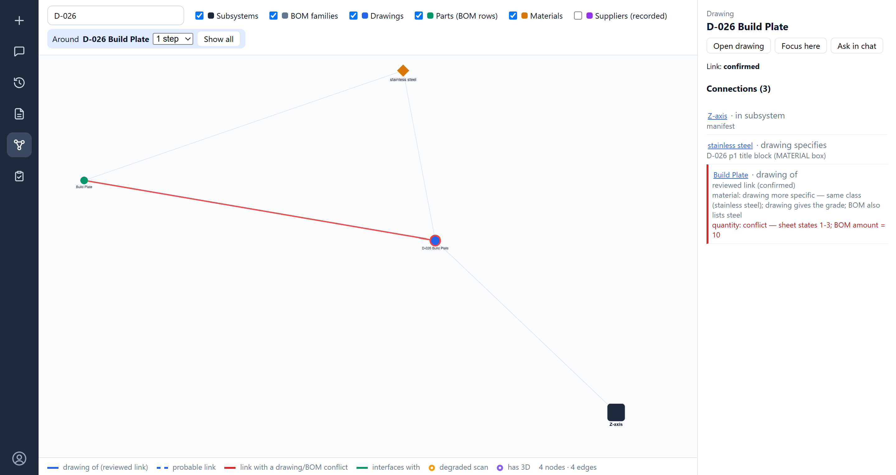
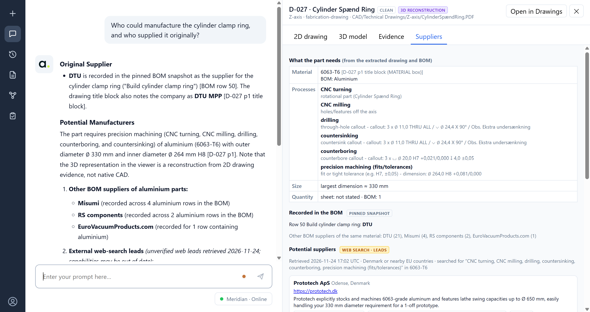
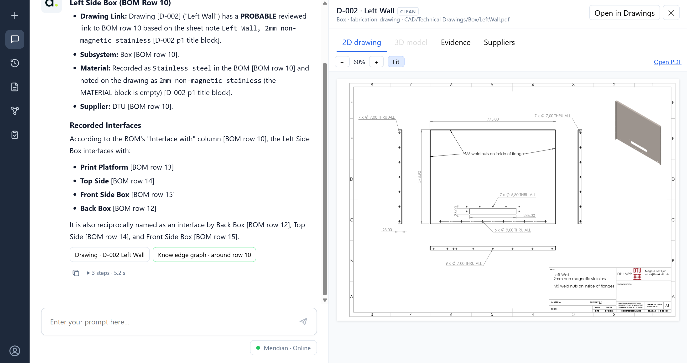
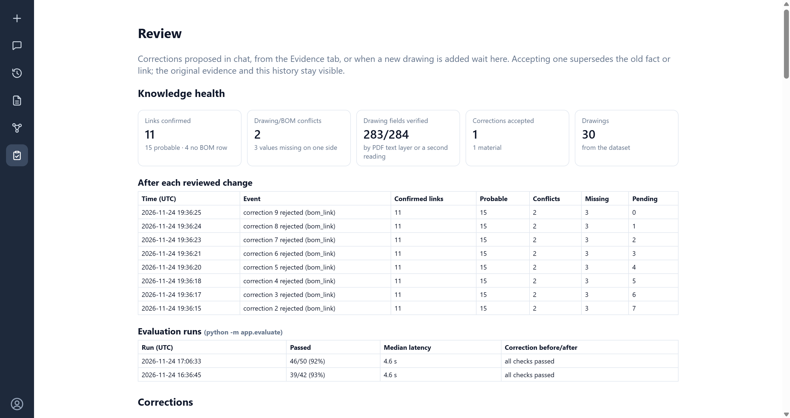
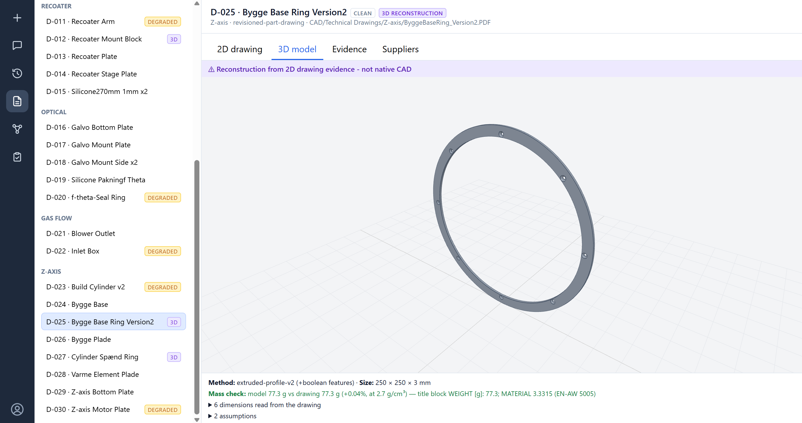
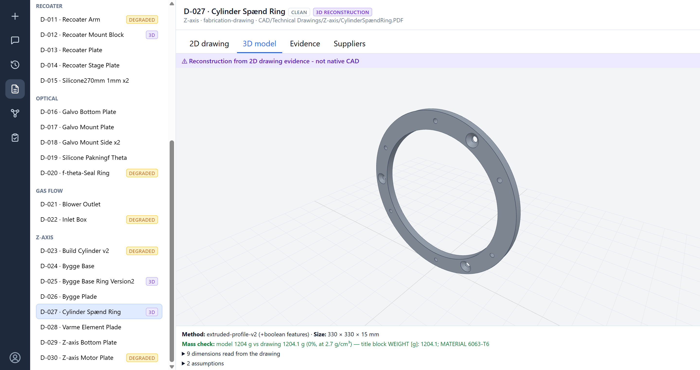

# Project Meridian — submission notes

A local app for asking questions about the OpenLPBF v2 design evidence (30 drawings + the pinned BOM).
Chat answers from structured knowledge extracted from the drawings and BOM, cites its sources, opens the
drawing (and a 3D reconstruction where one exists), and supports a human-reviewed correction loop.

- **Run it:** see [RUNNING.md](../RUNNING.md) (`.\start.cmd` on Windows, `./start.sh` elsewhere).
- **Measured results:** [data/eval/REPORT.md](../data/eval/REPORT.md) (generated by `python -m app.evaluate`).
- **Screenshots:** [docs/screenshots/](screenshots/).

## Architecture

```
dataset/ ──► ingest (Python, local) ──────────────────────────► data/meridian.db (SQLite, rebuilt any time)
             manifest · BOM rows · PDF text layer                 documents, bom_rows (raw, never edited)
             vision pass (Gemini, run once, committed) ──────────► facts (one claim + source + evidence each)
             reviewed drawing↔BOM links (links_curated.json)       drawing_annotations, drawing_quality
             'Interface with' → edges                              doc_bom_links, link_decisions, interfaces
             drawing vs BOM consistency checks                     consistency_checks, corrections, audit_log
             3D specs → .glb reconstructions                       models3d
                                   │
browser (React) ◄── FastAPI ◄──────┤
  chat · drawings · past chats ·   │  chat turn: retrieve evidence in Python → ONE streamed Gemini call
  graph · review                   │  (JSON: reply first, streamed to the browser as it is written; then
                                   │  drawings to open, graph focus, proposed correction) → open
                                   │  drawing/3D/graph, file correction for review
                                   └─ data/chats.db (chat history), data/corrections.jsonl (review journal)
```

**Backend** (`backend/app`): FastAPI + SQLite. `ingest/` builds the knowledge base, `chat/retrieve.py`
assembles evidence, `chat/agent.py` makes the model call, `knowledge.py` holds queries and the correction
lifecycle, `consistency.py` compares drawing and BOM claims, `recon/` builds 3D models, `evaluate.py` measures.
**Frontend** (`frontend/src`): React + Vite; PDF.js for drawings, three.js for 3D.

## Key decisions

1. **Raw evidence is immutable; knowledge is a list of sourced facts.** Every claim (a BOM cell, a title-block
   field, an accepted correction) is a row in `facts` with `source_ref` ("BOM row 32", "D-012 p1 title block",
   "correction 1"), a confidence, and evidence (sheet location, legibility, how it was checked). Drawing and BOM
   claims about the same thing are kept side by side and compared, never merged.

2. **Drawings are read once by a vision model, then verified independently.** Each sheet is transcribed
   (title block, every dimension and callout, as written, with a bounding box and legibility). Clean PDFs are
   checked token-by-token against their embedded text layer; degraded scans are read a second time at a
   different resolution and disagreements are downgraded to *partial*. "Box empty on the sheet" is stored
   differently from "illegible". The output is committed, so the app needs no API key to build.

3. **One model call per chat turn, with evidence retrieved in Python.** An earlier tool-calling loop needed 3–5
   sequential model calls per answer and was slow under load. Now Python selects the evidence (an index of all
   drawings and BOM rows, full detail for the parts the question matches, discrepancies, corrections) and the
   model returns structured JSON: the answer, which drawings to open, and any proposed correction. The model
   only sees retrieved evidence, so answers stay grounded; the app (not the model) opens drawings and files
   corrections. The JSON is streamed with the reply field first: the backend extracts the reply text as it
   arrives and sends it to the browser (`/api/chat/stream`, newline-delimited JSON), which shows it word by
   word and holds back unfinished markdown (an open `**`, a half-received table row). On a long answer the first
   words appeared after 3.0 s instead of 7.8 s for the whole reply. Drawings, 3D, graph and corrections are acted
   on once the answer is complete; the evaluation uses the same code path without streaming.

4. **Drawing↔BOM links are reviewed decisions, not fuzzy matches.** File names are often Danish and generic
   ("Door x2" fuzzy-matched "Back Door", "hinge" and "latch"). `data/links_curated.json` holds one decision per
   drawing — *confirmed* (title names the part), *probable* (judgement, with the reason) or *none* — each with
   its evidence. Fuzzy matches are only shown, as unconfirmed, for drawings without a decision.

5. **Consistency is computed, not asked of the model.** For every linked pair, material (by class: aluminium,
   stainless, steel, silicone, …) and stated quantity are compared: *agree*, *drawing more specific*,
   *conflict*, or *missing* on one side. The chat sees these verdicts with both values and references.

6. **Corrections supersede, never overwrite.** A correction proposed in chat is checked (subject exists, value
   changes, sources, and — new — the linked drawing's evidence) and waits for a human in the Review page.
   Accepting it marks the old fact *superseded* (kept, visible) and adds a new fact sourced to the correction;
   consistency checks re-run. Every event is journaled and replayed on rebuild with its original timestamp.

7. **3D is a reconstruction from 2D evidence, and is checked.** Each model is built from a spec listing every
   dimension with the drawing view it came from. The model's mass (volume × density) is compared with the
   title-block weight: all three are within 0.04%. The viewer labels it *Reconstruction from 2D drawing
   evidence – not native CAD*.

8. **Local first.** SQLite files, no services except the LLM API; chat history and the review journal stay on
   the machine (gitignored).

## Bonus features

### Knowledge graph (rail icon "Knowledge graph", or from chat)
An interactive graph (`/api/graph`, Cytoscape.js) built only from the sourced knowledge: subsystems, BOM
families, drawings, parts, material classes and recorded suppliers; edges for drawing-in-subsystem, part-in-family,
reviewed drawing↔part links (dashed = probable, red = a drawing/BOM conflict), BOM interfaces, materials the
drawing specifies / the BOM records, and recorded suppliers. Every edge carries its basis ("BOM row 10 'Interface
with': Top Side", "D-018 p1 title block", "reviewed link (probable)"). The family→subsystem edges are derived
from where linked drawings sit (e.g. BOM family "Build-plate" → Z-axis). Search, type filters, focus on a node's
1–3-step neighbourhood, and per-node actions (open drawing, ask in chat). Chat answers about relationships
attach "Knowledge graph · around …", which opens the graph focused there. 268 nodes / 562 edges.

### Potential part suppliers (Suppliers tab on any drawing, or ask in chat)
Three layers, kept separate in the UI and in chat answers:
1. **What the part needs**, derived from extracted evidence only: material (drawing + BOM), processes implied by
   the sheet with the text that implies each (e.g. "counterboring — callout: 3 x ⌴ Ø20,0 H7 ↧ 4,0"; "sheet-metal
   laser cutting and bending — note: 2mm non-magnetic stainless"), size envelope, quantity.
2. **Recorded in the BOM** (pinned snapshot): the part's supplier, and other BOM suppliers of the same material.
3. **Web-search leads** (on request): Gemini with Google Search grounding finds job shops offering those
   processes in that material (region: Denmark/nearby EU, from the project context). Each lead has its basis,
   location and website; the search queries and source sites are stored, each lead is marked whether its website
   appeared in the search results, and results are cached with the retrieval date and the caveat that they are
   unverified leads, not capabilities, quotes or availability. A first version that asked for JSON directly
   skipped the search and listed companies from memory — caught by the "in search results" flag; the search is
   now a separate grounded step and a result without sources is discarded.

### Richer learning loop
- **More update types:** besides changing a recorded value, a reviewer can now **change or confirm a
  drawing↔BOM link** (from chat, or "Confirm this link" / "Propose a different link…" in the Evidence tab).
  Accepting supersedes the old decision (kept, marked) and re-runs consistency checks.
- **Verification before acceptance:** link proposals are checked against the drawing — row exists, material
  class fits, the BOM family's subsystem matches the drawing's. Example: proposing D-012 → row 48 is flagged on
  both material (EN-AW 5005 vs stainless) and subsystem (Recoater vs Z-axis). Value corrections are checked
  against the linked drawing's material/quantity.
- **Ingest of a new drawing:** upload a PDF in the Drawings view (+). The server stores it, extracts the text
  layer, runs the vision pass, translates Danish titles, and — if a BOM row matches well — files a link proposal
  for review (proposed via "ingest"), with the same checks. Uploads survive rebuilds; duplicates are rejected.
- **No duplicate requests:** proposing a change that is already pending (from chat, the Evidence tab or an
  upload) returns the pending one instead of filing a second; "91,93" and "93, 91" count as the same link.
  Tested: re-uploading the heating-element plate sheet proposed row 51 with all checks passing; a galvo plate with
  no matching row proposed nothing (matching the reviewed "no BOM row" decision).
- **Measurements that show change:** the Review page's *Knowledge health* shows confirmed/probable links, open
  conflicts, missing values, verified drawing fields and accepted corrections by type; a snapshot is recorded
  after every accepted correction and ingested drawing, and the evaluation-run history (pass rate, latency,
  correction before/after) is listed alongside.

## Models, services and data

| What | Used for | Notes |
|---|---|---|
| Google Gemini API (`gemini-3.8-flash`, fallbacks `gemini-3.5-flash`, `gemini-3.1-flash-lite`) | chat answers; one-time vision pass; vision pass for uploaded drawings | Configurable in `.env`. Chat sends the question, recent history and retrieved evidence. The vision pass sends each drawing page as a PNG plus its PDF text layer. Personal names/emails/phone numbers from title blocks are not stored. |
| Gemini with Google Search grounding | supplier leads (on request) | Sends a text description of the part (material, processes, size, quantity; no drawing images). Results cached in `data/suppliers/` with retrieval date, queries and source sites. |
| Cytoscape.js | knowledge graph view | local (bundled) |
| PyMuPDF | PDF text layer, page rendering | local |
| rapidfuzz | part-name matching | local |
| trimesh, shapely, manifold3d | 3D reconstruction | local |
| PDF.js, three.js | 2D/3D viewers | local (bundled) |
| Dataset | `dataset/` (OpenLPBF v2, CERN-OHL-P-2.0) | see [ATTRIBUTION.md](../ATTRIBUTION.md) |

No other external data is used.

## Example questions

See the full list with expected answers in [data/eval/questions.json](../data/eval/questions.json) and the
answers in [data/eval/REPORT.md](../data/eval/REPORT.md). Good ones to try:

- *Show me the recoater mount block.* — opens D-012 and its 3D reconstruction.
- *What material is the cylinder clamp ring, according to its drawing and the BOM?* — 6063-T6 (drawing) vs
  Aluminium (BOM row 50), agreeing; opens D-027 with 3D.
- *Which drawings specify EN-AW 5005?* — six drawings across Recoater and Z-axis.
- *Where do the drawings and the BOM disagree?* — D-018 (sheet ×2 vs BOM 1) and D-026 (sheet "1–3 of each" vs
  BOM 10); plus materials missing on one side.
- *What weight does the door drawing D-001 give?* — the weight box is empty on the sheet; no guess.
- *What does the Left Side Box interface with?* — Print Platform, Top Side, Front Side Box, Back Box (BOM row 10).
- *Which BOM row is the Z-axis bottom plate drawing?* — none; explains why.
- Correction: *The amount for BOM row 81 is wrong, drawing D-018 says x2, so it should be 2.* → Review →
  Accept → ask again.

## Screenshots

| | |
|---|---|
| Chat opens the drawing and its 3D reconstruction (D-027) |  |
| A cited title-block field (Material) highlighted on the 2D sheet (D-012) |  |
| Evidence tab: reviewed BOM link and a drawing/BOM quantity conflict (D-026) |  |
| Knowledge graph around a drawing; red edge = drawing/BOM conflict, explained in the side panel (D-026) |  |
| Supplier question in chat; Suppliers tab with the part profile, recorded supplier and grounded leads |  |
| Interfaces question in chat: cited answer, drawing opened, and a button into the knowledge graph |  |
| Review page: knowledge health, history after each reviewed change, evaluation runs |  |
| 3D reconstruction of D-025 with its mass check against the title block |  |
| 3D reconstruction of D-027 with its mass check against the title block |  |

The third reconstruction (D-012) is reachable the same way (*Show me the recoater mount block.*).

The correction before/after transcript is in the last section of [REPORT.md](../data/eval/REPORT.md).

## Measurements

All numbers below were produced on 2026-11-19 (vision pass) and 2026-11-24 (everything else). Re-run with
`python -m app.evaluate` (chat) and `python -m app.ingest.vision --force` (extraction) from `backend/`.

### Chat quality, latency, cost, reproducibility — [full report](../data/eval/REPORT.md)

25 questions written with expected answers (organization, drawing↔BOM, interfaces, materials, supplier/cost,
clean vs noisy, uncertainty/abstention, visual, multi-turn, and the bonus features: graph, supplier leads, link
correction via chat), each run twice against a freshly built knowledge base with an empty correction journal.
A case passes only if *every* check passes (required facts mentioned, forbidden claims absent, required
drawings/3D/graph opened, expected correction filed, answered online).

| Metric | Latest run (25 cases) | Previous run (21 cases, before bonus work) |
|---|---|---|
| Pass rate | **46/50 runs (92%)** — bonus cases 7/8 | 39/42 (93%) |
| Reproducibility (same result + same drawings in both runs) | 23/25 cases | 20/21 |
| Latency per turn | median 4.6 s, p90 10.7 s, max 43.8 s | median 4.6 s, p90 9.4 s |
| Tokens per turn | median ≈ 8,100 input, ≈ 230 output | ≈ 7,800 / ≈ 200 |
| Fallback model needed | 0 turns | 0 turns |
| Correction before/after | all 5 checks pass (filed from chat, drawing evidence checked, answer changed 1 → 2, original kept as superseded, conflict resolved) | same |

Cost is ~8k input + ~0.2k output tokens per chat turn; multiply by your plan's per-token price. A supplier web
search is two extra calls (~30–40 s) and is cached per part. All runs are listed on the Review page and in
`data/eval/results/`.

### Drawing extraction (vision pass)

| Metric | Result |
|---|---|
| Drawings read | 30/30 (22 clean, 8 degraded) |
| Clean PDFs: transcribed fields confirmed by the embedded text layer | every non-empty field |
| Degraded scans: items where the two independent readings disagreed | 6 (D-003 ×2, D-009, D-023, D-030 ×2) → marked *partial* |
| Stored | 363 title-block facts (314 independently confirmed), 216 dimensions, 138 callouts |
| Cost / time | ≈ 74k input + 61k output + 84k thinking tokens; ~7 min with 4 parallel workers |
| Manual spot check | 5 sheets (D-001, D-012, D-023, D-025, D-027) compared against the images: no transcription errors found |

### Linking and consistency

| Metric | Before | After |
|---|---|---|
| Drawings with a BOM link | 22 (fuzzy filename only; e.g. "Door x2" → "Back Door", "hinge", "latch") | 30 with a reviewed decision: 11 confirmed, 15 probable, 4 no BOM row |
| Linked pairs checked | — | material: 13 agree, 12 agree (drawing more specific), 3 missing on one side; quantity: 4 agree, **2 conflicts** (D-018 ×2 vs BOM 1; D-026 "1–3 of each" vs BOM 10) |
| 'Interface with' references resolved to BOM rows | — | 24/24 |

### 3D reconstructions

| Drawing | Model mass vs title-block weight |
|---|---|
| D-012 Recoater Mount Block | 117.3 g vs 117.3 g (−0.03%) |
| D-025 Build Base Ring | 77.3 g vs 77.3 g (+0.04%) — also resolved the sheet's ambiguous 3,0/2,0 thickness |
| D-027 Cylinder Clamp Ring | 1204.0 g vs 1204.1 g (0.00%) |

### Observed failure modes and fixes during development

- **Slow answers under provider load.** The first design (model calls tools in a loop) took 27–243 s per turn
  when the API was busy, often ending in 503/504. Fixed by retrieving evidence in Python and making one call
  per turn, with a model fallback chain and a 60 s budget that falls back to offline matches.
- **Retrieval misses look like abstentions.** In the first evaluation run, three cases "failed" because the
  model correctly said a value was not in its evidence: long questions diluted fuzzy part matching
  ("laser source" scored 68 < 70) and English names did not match Danish drawing titles ("build base ring"
  vs "Bygge Base Ring"). Fixed with verbatim-name matching and a small Danish→English glossary; pass rate went
  from 36/42 to 39/42.
- **Generic words pulling in unrelated parts** ("plate" matched the Top Plate for a heating-element question).
  Fixed by keeping only matches close to the best one.

## Known limitations and error analysis

**Remaining evaluation failures (latest run: 4/50)** — all kept as measured rather than editing tests afterwards
- `supplier-cost` (both runs): the answer gave supplier, recorded cost and the snapshot caveat but not the
  laser's model number "MFSC-300W", which the question did not ask for — an over-strict test.
- `unsupported` (1 of 2): correctly abstained ("there is no record of the machine's maximum build rate") but in
  words the phrase check did not list — a false negative of string matching.
- `supplier-nosearch` (1 of 2): correctly said "No external web search has been run yet" and invented no
  companies; the check looked for "no web search" — again phrase matching.
- In the previous run, `open-3d-block` once omitted the word "reconstruction" in text (the viewer label is
  always shown). String checks cannot judge paraphrases; a model- or human-graded rubric would.

**Knowledge and linking**
- 15 of 30 drawing↔BOM links are *probable* judgement calls (proposed by the assistant from the extracted
  evidence) and should be reviewed by a person; two are explicitly ambiguous (D-001 → both doors, D-008 → two
  brackets). Link decisions live in `data/links_curated.json` and are easy to amend.
- Material consistency works at class level. The BOM mostly says "Aluminium", so an alloy mismatch inside a
  class (e.g. 7075 vs 5005) cannot be detected.
- Some inconsistencies are only found by reasoning across fields and are **not** detected automatically,
  e.g. D-026 lists thicknesses 25,0 and 15,0 while its stated weight implies ≈ 20 mm.
- Only 9 BOM rows fill in "Interface with", so interface traversal is shallow.

**Extraction**
- Vision transcriptions are verified (text layer or second reading), but the *meaning* attached to a dimension
  ("feature", e.g. "hole position to groove edge") is a model interpretation and is shown only as a hint.
- On degraded scans the check is self-consistency of one model at two resolutions; correlated errors are
  possible. These scans turned out to be fairly legible, so few fields were flagged.

**Chat**
- Part matching is fuzzy plus verbatim names and a small Danish glossary; unusual phrasings can still miss.
- The BOM index sent with every question has name, family, type, material, supplier, V&V and recorded cost,
  but not order numbers or links; those are only available for parts the question matches. (Cost was added
  after a review found "How much did the galvo scanner cost?" answered "not recorded": the weak name match
  left the row out of the detailed evidence, and the index had no cost column.)
- Answers depend on an external LLM; with no API key or during an outage the app falls back to search results
  and still opens drawings, but writes no prose answer.

**3D** — three parts, built as extruded profiles with boolean features; threads and fillets are not modelled.

**Privacy note** — vision output excludes the drafter's name, email and phone, but these appear in the
upstream PDFs themselves and therefore in the committed raw text-layer dumps (`data/extracted/D-0xx.json`)
and in screenshots of drawing sheets (e.g. the title block in screenshot 02).
